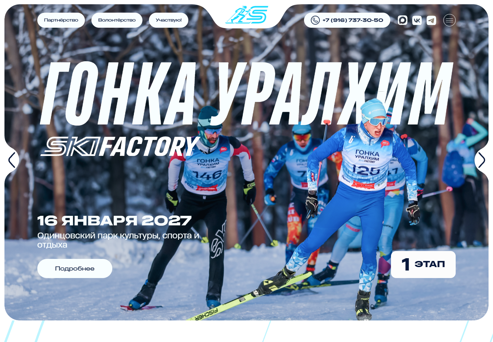

# Уралхим Ski Factory

Адаптивная вёрстка лендинга лыжной гонки «Уралхим Ski Factory» сезона 2027. Проект содержит главную страницу с этапами сезона и подробную страницу первого этапа: описание гонки, схемы трасс, стоимость участия, программу, место проведения, фотогалерею и партнёров.



## Технологии

- HTML5, CSS3 и JavaScript без сборки.
- Swiper для слайдеров и фотогалереи.
- GSAP и ScrollTrigger для анимаций.
- Локальные изображения, шрифты и библиотеки в `assets/`.


## Структура

```text
index.html          Главная страница с этапами сезона
stage1.html         Лендинг первого этапа
assets/css/         Стили и адаптивная вёрстка
assets/js/          Поведение интерфейса, анимации и настройки
assets/images/      Иллюстрации, фотографии и иконки
assets/fonts/       Локальные шрифты
assets/vendor/      Swiper и GSAP
docs/screenshot.png Скриншот лендинга
```

## Настройки

Проект представляет собой фронтенд-вёрстку. Серверная часть и обработка заявок в репозиторий не входят.

https://nrepin.github.io/ski/index.html 
